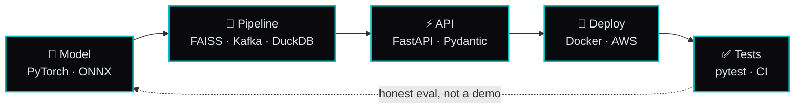

<!-- header -->
<p align="center">
  
</p>

<p align="center">
  <a href="https://www.sahilkumar.tech">
    
  </a>
</p>

<p align="center">
  <a href="https://www.sahilkumar.tech"></a>
  <a href="https://www.linkedin.com/in/sahil-kumar-a1b148247"></a>
  <a href="mailto:sahil115jangid@gmail.com"></a>
  
</p>

```text
sahil@archlinux ~ $ neofetch
                   -`                     sahil@archlinux
                  .o+`                    ---------------
                 `ooo/                    OS        Arch Linux x86_64 (yes, btw)
                `+oooo:                   Host      DCRUST, B.Tech ECE (AI/ML), final year
               `+oooooo:                  Role      AI/ML engineer
               -+oooooo+:                 Shell     zsh
             `/:-:++oooo+:                Editor    neovim + tmux
            `/++++/+++++++:               GPU       RTX 2050, 4 GB (everything has to fit)
           `/++++++++++++++:              Langs     Python, Go, C/C++, CUDA
          `/+++ooooooooooooo/`            Focus     speech, retrieval, on-device ML
         ./ooosssso++osssssso+`           Robotics  2x e-Yantra (IIT Bombay), Lead @ THINKBOTS
        .oossssso-````/ossssss+`          Building  an LLM serving engine from scratch
       -osssssso.      :ssssssso.         Uptime    final year, shipping
      :osssssss/        osssso+++.
     /ossssssss/        +ssssooo/-        ███ ███ ███ ███ ███ ███ ███
   `/ossssso+/:-        -:/+osssso+-
  `+sso+:-`                 `.-/+oso:
 `++:.                           `-/+/
 .`                                 `/
```

## `$ cat pipeline.md`

Every project goes the full distance. A notebook result is a hypothesis, not a product.



## `$ ls ~/featured`

<table>
  <tr>
    <td width="50%" valign="top">
      <h3>🔍 <a href="https://github.com/Sahiljangra115/Holmes">Holmes</a></h3>
      AI-content provenance detector. Fuses 4 independent signals (DeBERTa-v3, C2PA/EXIF, SynthID, image forensics) into a calibrated confidence with an uncertainty band, not a yes/no verdict.
      <br/><br/>
      <code>ONNX Runtime</code> <code>FastAPI</code> <code>AWS Lambda</code>
    </td>
    <td width="50%" valign="top">
      <h3>🖼️ <a href="https://github.com/Sahiljangra115/image-N">image-N</a></h3>
      Multimodal RAG with no framework glue. CLIP + FAISS two-stage retrieval, local Ollama LLMs, every stage readable top to bottom. Runs on a 4 GB GPU.
      <br/><br/>
      <code>CLIP</code> <code>FAISS</code> <code>Ollama</code> <code>FastAPI</code>
    </td>
  </tr>
  <tr>
    <td width="50%" valign="top">
      <h3>🥗 <a href="https://github.com/Sahiljangra115/HealthByte">HealthByte</a></h3>
      EfficientNet-B0 food classifier with uncertainty-banded calorie estimates and statistically honest correlations (Spearman + Benjamini-Hochberg FDR). Picks honest over impressive.
      <br/><br/>
      <code>EfficientNet</code> <code>SQLite</code> <code>FastAPI</code>
    </td>
    <td width="50%" valign="top">
      <h3>🤖 <a href="https://github.com/Sahiljangra115/Noir">NOIR</a></h3>
      Autonomous robot assistant. Three concurrent real-time loops (YOLOv8 vision, STT/TTS voice, local LLM), an ESP32 hardware bridge, a Flutter control app, and ~2,500 lines of tests.
      <br/><br/>
      <code>YOLOv8</code> <code>Gemma</code> <code>ESP32</code> <code>Flutter</code>
    </td>
  </tr>
</table>

<details>
<summary><b>More on the bench</b> (click to expand)</summary>
<br/>

| Repo | One line |
|---|---|
| [NyxCore](https://github.com/Sahiljangra115/NyxCore) | TinyML anomaly detection inside XRCE-DDS streams on an ESP32-S3, with micro-ROS lifecycle management |
| [smogcast](https://github.com/Sahiljangra115/smogcast) | 24h / 48h PM2.5 forecasts for Delhi NCR, drift detection, gated retraining, canary rollback |
| [credit-risk-policy](https://github.com/Sahiljangra115/credit-risk-policy) | Calibrated LightGBM default model turned into a cost-based lending policy with fairness checks |
| [shrota](https://github.com/Sahiljangra115/shrota) | Timestamp-grounded audio intelligence for multi-speaker, code-mixed lectures and podcasts |
| [Path-tracer](https://github.com/Sahiljangra115/Path-tracer) | Monte Carlo path tracer in C++17 with a parallel CUDA port and zero dependencies |

</details>

## `$ cat now.txt`

```diff
+ mini-inference-engine   LLM serving from scratch: paged KV cache, continuous batching,
+                         chunked prefill, Triton kernels. Qwen2.5-0.5B on a 4 GB GPU.
+ straightline            Flow matching from scratch: DiT backbone, reflow, MeanFlow,
+                         an honest quality-vs-NFE table on CIFAR-10.
! both in progress. the READMEs track which phases are done.
```

## `$ which tools`

<p align="center">
  
  <br/>
  
  <br/>
  
</p>

<p align="center"><sub>plus LangGraph · FAISS · Qdrant · ONNX Runtime · faster-whisper · CUDA · ESP-IDF · FreeRTOS · micro-ROS</sub></p>

## `$ git log --graph`

<p align="center">
  
</p>

<p align="center">
  <picture>
    <source media="(prefers-color-scheme: dark)" srcset="https://raw.githubusercontent.com/Sahiljangra115/Sahiljangra115/output/snake-dark.svg"/>
    
  </picture>
</p>

<p align="center">
  
  
</p>

## `$ ls ~/writing ~/learn`

<table>
  <tr>
    <td width="55%" valign="top">
      <b>✍️ Latest posts</b>
      <br/><br/>
      🚨 <a href="https://www.sahilkumar.tech/blog/agents-of-signoz">The Alert That Woke an Agent</a> <sub>Jul 2026</sub><br/>
      🛰️ <a href="https://www.sahilkumar.tech/blog/micro-ros-xrce-dds">Micro-ROS and XRCE-DDS: How ROS2 Fits into Microcontrollers</a> <sub>May 2026</sub><br/>
      🔁 <a href="https://www.sahilkumar.tech/blog/the-constant">The Constant</a> <sub>May 2026</sub><br/>
      🧭 <a href="https://www.sahilkumar.tech/blog">all posts →</a>
    </td>
    <td width="45%" valign="top">
      <b>🎓 Free courses I wrote</b>
      <br/><br/>
      <a href="https://www.sahilkumar.tech/learn/docker"></a>
      <a href="https://www.sahilkumar.tech/learn/kubernetes"></a>
      <a href="https://www.sahilkumar.tech/learn/linux"></a>
      <br/>
      <a href="https://www.sahilkumar.tech/learn/sql"></a>
      <a href="https://www.sahilkumar.tech/learn/git"></a>
      <a href="https://www.sahilkumar.tech/learn/langgraph"></a>
    </td>
  </tr>
</table>

## `$ fortune`

> *"If your eval only reports the wins, it is a demo, not an eval."*

<p align="center">
  <sub>Building the next generation of robots, AI systems, or just want to talk Linux? My inbox is open.</sub>
</p>


