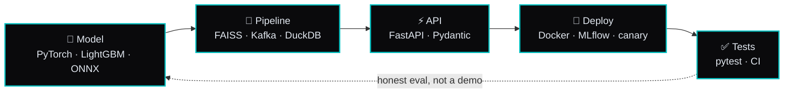

<!-- header -->
<p align="center">
  
</p>

<p align="center">
  <a href="https://sahilkumar.tech">
    
  </a>
</p>

<p align="center">
  <a href="https://sahilkumar.tech"></a>
  <a href="https://www.linkedin.com/in/sahilkumar119/"></a>
  <a href="mailto:sahil115jangid@gmail.com"></a>
  
</p>

```text
sahil@archlinux ~ $ neofetch
                   -`                     sahil@archlinux
                  .o+`                    ---------------
                 `ooo/                    OS        Arch Linux x86_64 (yes, btw)
                `+oooo:                   Host      DCRUST, B.Tech ECE (AI/ML), final year
               `+oooooo:                  Role      AI/ML engineer
               -+oooooo+:                 Shell     zsh
             `/:-:++oooo+:                Editor    neovim + tmux
            `/++++/+++++++:               GPU       RTX 2050, 4 GB (everything has to fit)
           `/++++++++++++++:              Langs     Python, Go, C/C++, CUDA, Kotlin
          `/+++ooooooooooooo/`            Focus     speech, retrieval, forecasting, on-device ML
         ./ooosssso++osssssso+`           Robotics  2x e-Yantra (IIT Bombay), Lead @ THINKBOTS
        .oossssso-````/ossssss+`          Building  NOIR v0.4.0, YOLO on Indian roads
       -osssssso.      :ssssssso.         Uptime    final year, shipping
      :osssssss/        osssso+++.
     /ossssssss/        +ssssooo/-        ███ ███ ███ ███ ███ ███ ███
   `/ossssso+/:-        -:/+osssso+-
  `+sso+:-`                 `.-/+oso:
 `++:.                           `-/+/
 .`                                 `/
```

## `$ cat pipeline.md`

Every project goes the full distance. A notebook result is a hypothesis, not a product. The eval table ships with the misses in it.



## `$ ls ~/featured`

Six projects, each with a number you can check in its README.

<table>
  <tr>
    <td width="50%" valign="top">
      <h3>🌫️ <a href="https://github.com/Sahiljangra115/smogcast">smogcast</a></h3>
      PM2.5 forecasts for Delhi NCR, 24 h and 48 h ahead, with drift detection, gated retraining, a model registry with canary and rollback, and Prometheus-instrumented serving.
      <br/><br/>
      <b>24 h MAE 26.4 vs 29.4 µg/m³ persistence. Rollback in 56 ms median. Drift-gated retrain did not beat a blind monthly refit, and the README says so.</b>
      <br/><br/>
      <code>HistGradientBoosting</code> <code>MLflow</code> <code>FastAPI</code> <code>Prometheus</code>
    </td>
    <td width="50%" valign="top">
      <h3>🏦 <a href="https://github.com/Sahiljangra115/credit-risk-policy">credit-risk-policy</a></h3>
      Home Credit default model turned into a lending policy: WoE scorecard vs LightGBM vs CatBoost, isotonic calibration, cost-based cutoff, fairness ratios, reject inference, A/B sizing.
      <br/><br/>
      <b>Test AUC 0.782, ECE 0.0034 after calibration. Cutoff cuts approved-pool default rate 7.97% → 5.79% at 91% approval.</b>
      <br/><br/>
      <code>DuckDB</code> <code>LightGBM</code> <code>TreeSHAP</code> <code>FastAPI</code>
    </td>
  </tr>
  <tr>
    <td width="50%" valign="top">
      <h3>🎙️ <a href="https://github.com/Sahiljangra115/shrota">shrota</a></h3>
      Timestamp-grounded transcripts for multi-speaker, code-mixed lectures and podcasts: VAD, diarization, Whisper large-v3, alignment, chapters, hybrid search, subtitles, web player.
      <br/><br/>
      <b>large-v3 + diarization in 2.11 GB peak VRAM, RTF 0.25. DER 9.1% hit target. English WER 19.0% missed the 12% target, published anyway.</b>
      <br/><br/>
      <code>faster-whisper</code> <code>pyannote</code> <code>BGE-M3</code> <code>FAISS</code>
    </td>
    <td width="50%" valign="top">
      <h3>🖼️ <a href="https://github.com/Sahiljangra115/image-N">image-N</a></h3>
      Multimodal RAG with no framework glue. Two-stage text retrieval with a cross-encoder reranker, CLIP image retrieval, local Ollama LLMs. Every stage readable top to bottom.
      <br/><br/>
      <b>Image recall@1 0.561 → 0.606 and recall@5 0.809 → 0.851 moving CLIP ViT-B/32 → ViT-L/14. Runs on a 4 GB GPU.</b>
      <br/><br/>
      <code>CLIP</code> <code>FAISS</code> <code>Ollama</code> <code>Gradio</code>
    </td>
  </tr>
  <tr>
    <td width="50%" valign="top">
      <h3>🤖 <a href="https://github.com/Sahiljangra115/Noir">NOIR</a></h3>
      Autonomous robot assistant. Three concurrent loops (YOLOv8 vision, wake-word → Whisper → Gemma 4 → Piper voice, Flask-SocketIO bridge), an ESP32 motor bridge with a hardware watchdog, and a native Android app.
      <br/><br/>
      <b>167 Python tests, 67% coverage. 400 ms firmware watchdog fed by a 100 ms heartbeat. One motor owner, E-STOP latches.</b>
      <br/><br/>
      <code>YOLOv8</code> <code>Gemma 4</code> <code>ESP-IDF</code> <code>Kotlin · Compose</code>
    </td>
    <td width="50%" valign="top">
      <h3>🚌 <a href="https://github.com/Sahiljangra115/delhi-bus-stream">delhi-bus-stream</a></h3>
      Streaming ETA and bus-bunching prediction on Kafka: GTFS-realtime positions, a Feast feature store with online/offline parity, HistGradientBoosting scoring, overload drain tests.
      <br/><br/>
      <b>ETA MAE 11.2 s vs 185.8 s static schedule on simulator data. End-to-end p99 168 ms. 132k-message backlog drained with 0 lost.</b>
      <br/><br/>
      <code>Kafka</code> <code>GTFS-realtime</code> <code>Feast</code> <code>scikit-learn</code>
    </td>
  </tr>
</table>

<details>
<summary><b>More on the bench</b> (click to expand)</summary>
<br/>

| Repo | One line | Where it stands |
|---|---|---|
| [nerv-orchestrator](https://github.com/Sahiljangra115/nerv-orchestrator) | Local LLM orchestrator: a 22M-param embedding router splits and routes subtasks to quantized Ollama models | Router 0.90 held-out accuracy, plans in ~7 ms warm vs ~45 s for an LLM planner |
| [idd-edge-vision](https://github.com/Sahiljangra115/idd-edge-vision) | YOLO11n on Indian dashcam frames: fine-tune, ONNX export, INT8 quantization, per-precision edge latency | COCO baseline measured (mAP50-95 18.9 on 450 frames, auto-rickshaw AP 0.0). Fine-tune and quantization next |
| [NyxCore](https://github.com/Sahiljangra115/NyxCore) | TinyML anomaly watchdog inside XRCE-DDS streams on an ESP32-S3, as a micro-ROS lifecycle node | ~400 B total model footprint, pure C. Detector accuracy not yet measured against an independent reference |
| [Holmes](https://github.com/Sahiljangra115/Holmes) | AI-content provenance detector fusing DeBERTa-v3, C2PA/EXIF, SynthID, image forensics into a calibrated confidence band | Pipeline built, eval table still to be filled |
| [HealthByte](https://github.com/Sahiljangra115/HealthByte) | EfficientNet-B0 food classifier, calorie ranges instead of point estimates, Spearman + Benjamini-Hochberg correlations | Pipeline built, eval table still to be filled |
| [sql-analyst-agent](https://github.com/Sahiljangra115/sql-analyst-agent) | Text-to-SQL agent: LangGraph workflow, sandboxed execution, bounded self-correction, BIRD Mini-Dev harness | Code complete, 500 gold queries pass the sandbox, accuracy run pending |
| [hinglish-lora](https://github.com/Sahiljangra115/hinglish-lora) | LoRA fine-tune of Qwen2.5-0.5B for Hinglish→English MT and NER on COMI-LINGUA | Data and training code ready, training run pending |
| [Path-tracer](https://github.com/Sahiljangra115/Path-tracer) | Monte Carlo path tracer in C++17 with a parallel CUDA port and zero dependencies | Complete |
| [Pixelock](https://github.com/Sahiljangra115/Pixelock) | Android 13+ focus app: blocks short-video feeds, runs timers you cannot end on impulse | Builds, sideload only, online features untested against live backends |

</details>

## `$ cat now.txt`

```diff
+ Noir v0.4.0             Native Android app replaced Flutter. VLM "go to the table" navigation,
+                         voice fast path without the LLM, opt-in JSONL benchmark recorder.
+ idd-edge-vision         COCO YOLO11n baseline measured on IDD frames. Next: fine-tune, ONNX,
+                         INT8, per-precision latency on CPU and CUDA.
! mini-inference-engine   Paged KV cache + continuous batching serving engine. Scaffold with a plan
! straightline            Flow matching from scratch on CIFAR-10. Scaffold with a plan
! both have empty results tables on purpose. they get listed above when the numbers exist.
```

## `$ which tools`

<p align="center">
  
  <br/>
  
  <br/>
  
</p>

<p align="center"><sub>plus LightGBM · MLflow · Feast · FAISS · ONNX Runtime · faster-whisper · LangGraph · CUDA · ESP-IDF · FreeRTOS · micro-ROS</sub></p>

## `$ git log --graph`

<p align="center">
  
</p>

<p align="center">
  <picture>
    <source media="(prefers-color-scheme: dark)" srcset="https://raw.githubusercontent.com/Sahiljangra115/Sahiljangra115/output/snake-dark.svg"/>
    
  </picture>
</p>

## `$ ls ~/writing ~/learn`

<table>
  <tr>
    <td width="55%" valign="top">
      <b>✍️ Latest posts</b>
      <br/><br/>
      🚨 <a href="https://sahilkumar.tech/blog/agents-of-signoz">The Alert That Woke an Agent</a> <sub>Jul 2026</sub><br/>
      🛰️ <a href="https://sahilkumar.tech/blog/micro-ros-xrce-dds">Micro-ROS and XRCE-DDS: How ROS2 Fits into Microcontrollers</a> <sub>May 2026</sub><br/>
      🔁 <a href="https://sahilkumar.tech/blog/the-constant">The Constant</a> <sub>May 2026</sub><br/>
      🧭 <a href="https://sahilkumar.tech/blog">all posts →</a>
    </td>
    <td width="45%" valign="top">
      <b>🎓 Free courses I wrote</b>
      <br/><br/>
      <a href="https://sahilkumar.tech/learn/docker"></a>
      <a href="https://sahilkumar.tech/learn/kubernetes"></a>
      <a href="https://sahilkumar.tech/learn/linux"></a>
      <br/>
      <a href="https://sahilkumar.tech/learn/sql"></a>
      <a href="https://sahilkumar.tech/learn/git"></a>
      <a href="https://sahilkumar.tech/learn/langgraph"></a>
    </td>
  </tr>
</table>

## `$ fortune`

> *"If your eval only reports the wins, it is a demo, not an eval."*

<p align="center">
  <sub>Building the next generation of robots, AI systems, or just want to talk Linux? My inbox is open.</sub>
</p>


